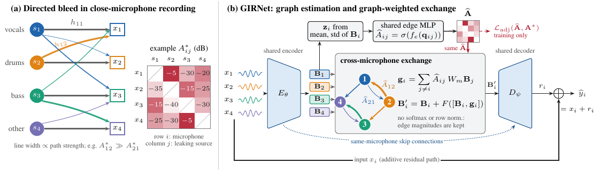
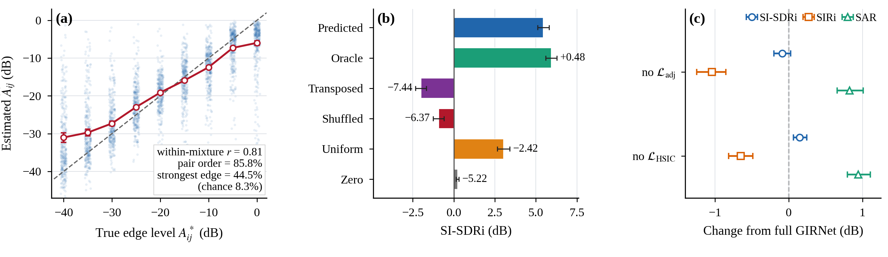
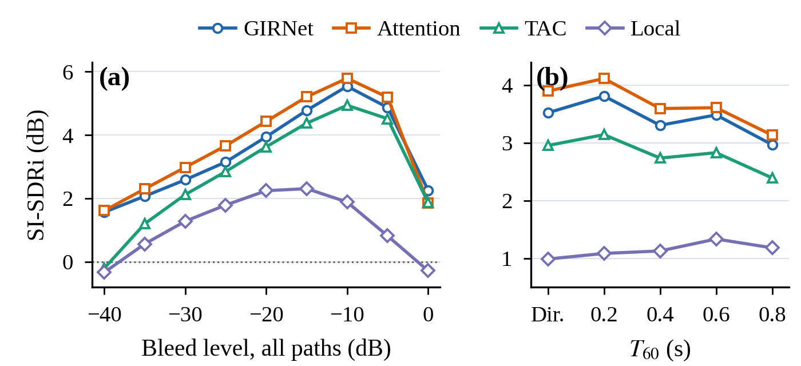
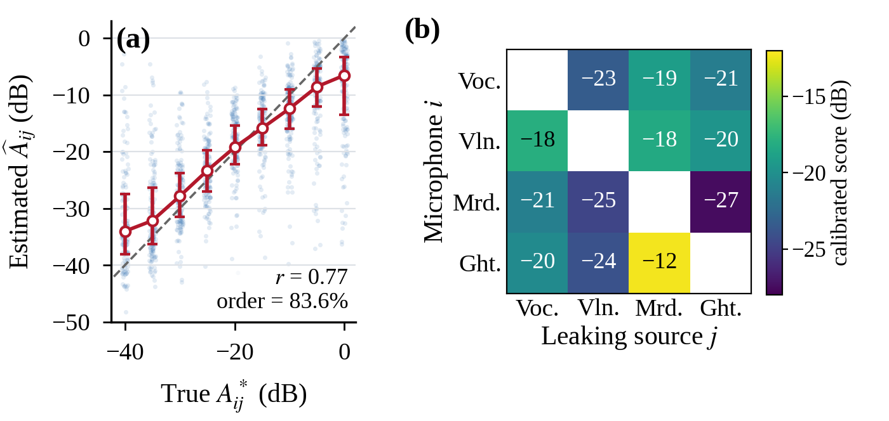

  <a href="https://listeningtech.github.io/girnet/">Canonical supplementary site</a> ·
  <a href="https://github.com/its-rajesh/GIRNet">Code and protocols</a>

---

## Problem and method

In an ordered close-microphone recording, microphone \(i\) is assigned to
source \(i\) but also records the other performers. These paths are directed:
source \(j\) can leak strongly into microphone \(i\) even when the reverse path
is weak. A single global bleed level therefore cannot describe the recording.

GIRNet is an end-to-end waveform separator that estimates a segment-level
directed graph. Edge \(A_{ij}\) represents source \(j\) leaking into microphone
\(i\). The same unnormalized edge values are reported as the bleed graph and
used to weight cross-microphone bottleneck messages. The decoder predicts an
additive waveform correction.

The principal heterogeneous benchmark contains all nine directed path levels
from \(-40\) to 0 dB within every mixture. Across nine balanced patterns, every
directed edge assumes every level. This prevents graph recovery from reducing
to estimation of one global contamination value.

---

## Main results

The official heterogeneous test set contains 4,500 five-second mixtures from
50 held-out MUSDB18HQ songs, producing 18,000 source estimates and 54,000
directed edge estimates.

| Quantity | Result |
|---|---:|
| SI-SDR improvement | 5.447 dB |
| SIR improvement | 12.152 dB |
| SAR | 15.136 dB |
| Within-mixture graph correlation | 0.810 |
| Pair-order accuracy | 85.75% |
| Strongest-edge accuracy | 44.51% (8.33% chance) |
| Edge MAE | 5.29 dB |

The edge estimates preserve relative path structure but compress the dB range;
they should be interpreted as an ordered, approximately calibrated
representation rather than precision acoustic measurements.

### Fixed-weight graph interventions

The separator weights remain fixed while only the graph supplied to message
passing changes.

| Graph used | SI-SDRi | Difference from predicted |
|---|---:|---:|
| Predicted | 5.447 dB | — |
| Oracle | 5.931 dB | +0.484 dB [0.361, 0.613] |
| Transposed oracle | -1.990 dB | -7.437 dB [-7.808, -7.074] |
| Shuffled oracle | -0.918 dB | -6.366 dB [-6.710, -6.030] |
| Uniform | 3.025 dB | -2.423 dB [-2.619, -2.229] |
| Zero | 0.229 dB | -5.218 dB [-5.548, -4.889] |

Transposition preserves each microphone pair's two edge values but reverses
their directions. Its large degradation shows that separation depends on
directed source-to-microphone assignment, not merely the edge-value multiset.

### Controlled loss ablations

Removing adjacency supervision leaves SI-SDRi statistically unresolved
(-0.086 dB [-0.202, 0.027]) but reduces graph correlation from 0.810 to 0.587,
increases edge MAE from 5.29 to 10.62 dB, and reduces SIRi by 1.041 dB.
Adjacency supervision therefore supplies graph fidelity and improves
interference rejection. Removing HSIC increases SI-SDRi by 0.149 dB, reduces
SIRi by 0.648 dB, and increases SAR by 0.942 dB relative to the full model.

---

## External validation

On 194 SDXDB23/MoisesDB songs, evaluated without fine-tuning, GIRNet and the
equal-size attention model are tied in SI-SDRi. GIRNet provides 0.766 dB higher
SIRi [0.545, 0.997] and 0.508 dB higher SAR [0.341, 0.672]. HTDemucs remains the
strongest aggregate separator.

After leave-one-performance-out adaptation to six Sanidha performances,
GIRNet reaches 8.421 dB SI-SDRi and retains graph correlation 0.771, 83.62%
pair-order accuracy, and 44.63% strongest-edge accuracy.

For 46 reference-free Saraga concert recordings, the population-median model
graph identifies mridangam→ghatam as the strongest direction. These scores are
model-derived relative descriptors, not measured acoustic gains or
contamination percentages.

---

## Reference-free Saraga audio

The examples below compare an input concert microphone with the GIRNet output.
No isolated ground truth is available, so these clips support listening and
qualitative inspection only.

### Example 1

| Microphone | Input | GIRNet output |
|---|---|---|
| Vocals | <audio controls preload="none"><source src="/rajesh/audios/girnet/ex1/bvocal.wav" type="audio/wav"></audio> | <audio controls preload="none"><source src="/rajesh/audios/girnet/ex1/mvocal.wav" type="audio/wav"></audio> |
| Violin | <audio controls preload="none"><source src="/rajesh/audios/girnet/ex1/bviolin.wav" type="audio/wav"></audio> | <audio controls preload="none"><source src="/rajesh/audios/girnet/ex1/mviolin.wav" type="audio/wav"></audio> |
| Mridangam | <audio controls preload="none"><source src="/rajesh/audios/girnet/ex1/bmridangam.wav" type="audio/wav"></audio> | <audio controls preload="none"><source src="/rajesh/audios/girnet/ex1/mmridangam.wav" type="audio/wav"></audio> |

### Example 2

| Microphone | Input | GIRNet output |
|---|---|---|
| Vocals | <audio controls preload="none"><source src="/rajesh/audios/girnet/ex2/bvocal.wav" type="audio/wav"></audio> | <audio controls preload="none"><source src="/rajesh/audios/girnet/ex2/mvocal.wav" type="audio/wav"></audio> |
| Violin | <audio controls preload="none"><source src="/rajesh/audios/girnet/ex2/bviolin.wav" type="audio/wav"></audio> | <audio controls preload="none"><source src="/rajesh/audios/girnet/ex2/mviolin.wav" type="audio/wav"></audio> |
| Mridangam | <audio controls preload="none"><source src="/rajesh/audios/girnet/ex2/bmridangam.wav" type="audio/wav"></audio> | <audio controls preload="none"><source src="/rajesh/audios/girnet/ex2/mmridangam.wav" type="audio/wav"></audio> |

### Example 3

| Microphone | Input | GIRNet output |
|---|---|---|
| Vocals | <audio controls preload="none"><source src="/rajesh/audios/girnet/ex3/bvocal.wav" type="audio/wav"></audio> | <audio controls preload="none"><source src="/rajesh/audios/girnet/ex3/mvocal.wav" type="audio/wav"></audio> |
| Violin | <audio controls preload="none"><source src="/rajesh/audios/girnet/ex3/bviolin.wav" type="audio/wav"></audio> | <audio controls preload="none"><source src="/rajesh/audios/girnet/ex3/mviolin.wav" type="audio/wav"></audio> |
| Mridangam | <audio controls preload="none"><source src="/rajesh/audios/girnet/ex3/bmridangam.wav" type="audio/wav"></audio> | <audio controls preload="none"><source src="/rajesh/audios/girnet/ex3/mmridangam.wav" type="audio/wav"></audio> |

---

## Scope

The current implementation assumes four ordered microphones and
segment-constant paths. Supporting unknown source–microphone correspondence,
arbitrary channel counts with one checkpoint, and time-varying path estimates
remains future work.
